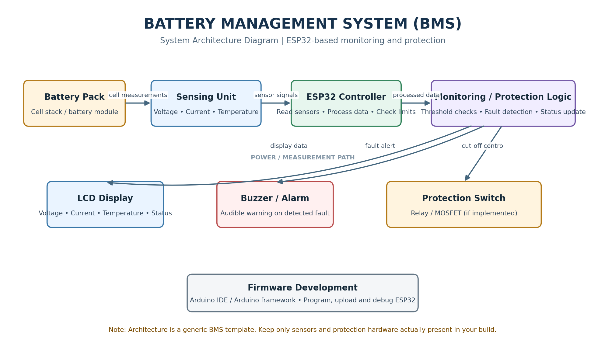
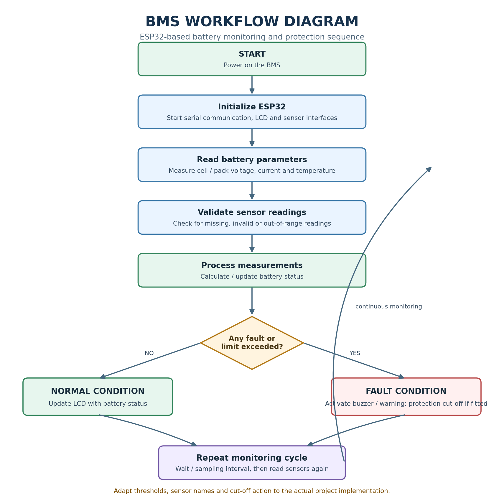

# ESP32-Based Battery Management System (BMS)

## Project Overview
This project implements an intelligent Battery Management System using ESP32, Wokwi Simulator and Blynk IoT.

The system monitors a four-cell lithium battery pack, detects abnormal conditions, provides safety protection and displays real-time battery information through a cloud dashboard.

## Technologies Used
- ESP32
- Arduino IDE / C++
- Wokwi Simulator
- Blynk IoT Platform
- I2C LCD Display
- Battery voltage sensors
- Relay and buzzer

## Main Features
1. Multi-cell voltage monitoring.
2. Battery health and imbalance calculation.
3. Event-driven safety protection.
4. LCD-based monitoring and diagnostics.
5. Fault detection and fault-tolerant runtime modes.
6. Cloud telemetry using Blynk.
7. Historical voltage monitoring.
8. Battery risk assessment and operator recommendations.

## Project Structure
- `src/` – ESP32 source code and library requirements.
- `docs/` – Technical report and diagrams.
- `screenshots/` – Simulation and dashboard screenshots.
- `video/` – Demonstration video information.

## Project Links
- Wokwi Project: [Add your public Wokwi link here]
- GitHub Repository: [Add your repository link here]

## Setup Instructions
1. Open the Wokwi project.
## System Architecture Diagram

## Workflow Diagram

   
3. Configure the required Blynk credentials privately.
4. Run the ESP32 simulation.
5. Monitor battery readings through the Serial Monitor, LCD and Blynk dashboard.

## Project Outcome
The system provides battery monitoring, fault detection, safety control and cloud-based battery intelligence through an integrated embedded platform.
